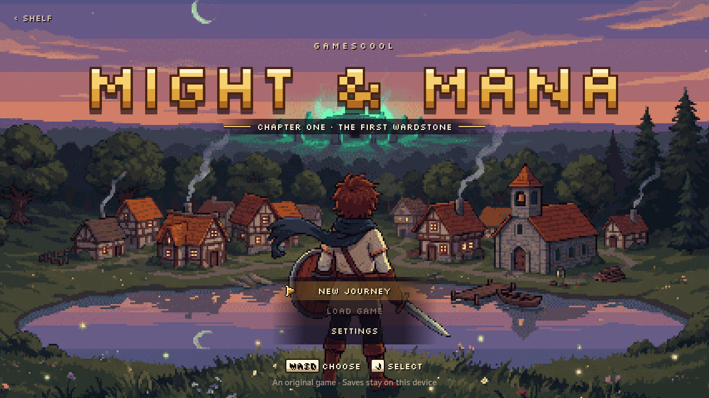
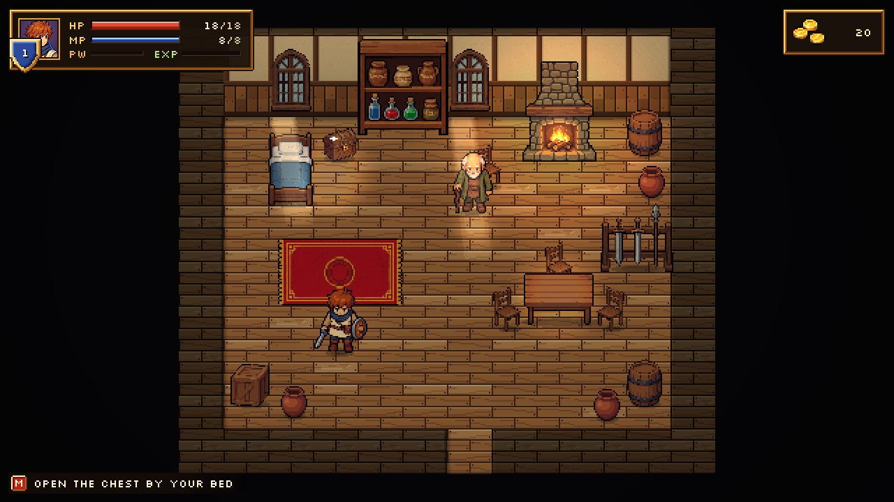

# Might & Mana

A top-down pixel-art action RPG that runs in the browser. Cut grass, take quests, gear up in
Larkmoor and relight the first wardstone. One hero, real-time sword and spell combat, shops,
side quests, a boss, and three save slots that stay on your device.

Play it: https://gamescool.id/might-and-mana




## Run it

Needs Node 20 or newer.

```bash
npm install
npm run dev
```

Then open the address Vite prints. `npm run build` writes a static site to `dist/` that any
static host can serve from the site root.

Controls: WASD or arrows to move, J to attack, plus a gamepad or touch controls on a phone.
The full list is under Settings → Controls in the game.

## How it is built

No game engine: TypeScript, a 2D canvas and React for the menus.

| Path | What is there |
| --- | --- |
| `lib/game-05/contract.ts` | The shared types every part codes against |
| `lib/game-05/sim/` | The simulation: fixed 60 Hz step, seeded RNG, combat, AI, collision. No DOM, so it runs in Node |
| `lib/game-05/content/` | Maps, monsters, items, quests, dialog, shops, spells |
| `lib/game-05/render/` | Canvas renderer: atlas, camera, lighting, effects |
| `lib/game-05/audio/` | Web Audio music and sound effects |
| `lib/game-05/input/` | Keyboard, gamepad and touch |
| `lib/game-05/save.ts` | Saves in `localStorage` |
| `components/game-05/` | Title, HUD, menus, shop, map and touch UI |
| `public/games/game-05/` | Art atlas, UI sheets, music and sound |
| `docs/game-05/CONTENT.md` | The content bible: places, people, quests, numbers |

Maps are written one character per tile in `lib/game-05/content/maps/`.

## Tests

The simulation runs headless, so the tests play the game without a browser.

```bash
npm test          # unit tests, quest flows, content check, reachability
npm run test:bot  # a bot plays Chapter One start to finish on four seeds
```

`node --import tsx tests/game-05/map-tool.mjs all` prints and checks every map.

## Licence

Code: MIT, see [LICENSE](LICENSE).

The fonts in `public/fonts/` (Silkscreen, M PLUS 2) are under the SIL Open Font License; their
licence files sit next to them.
